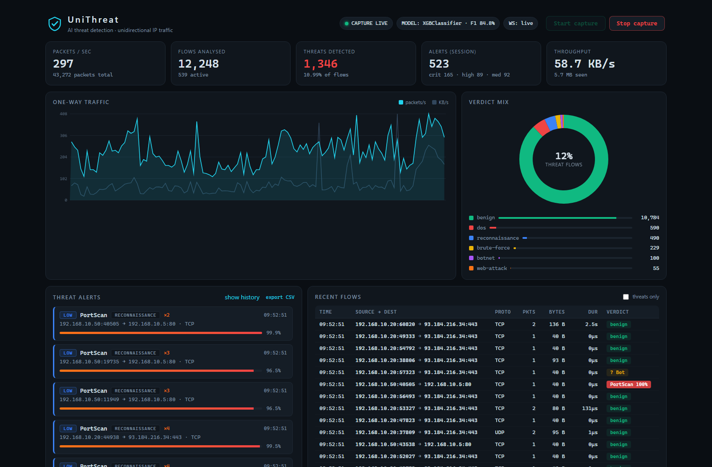
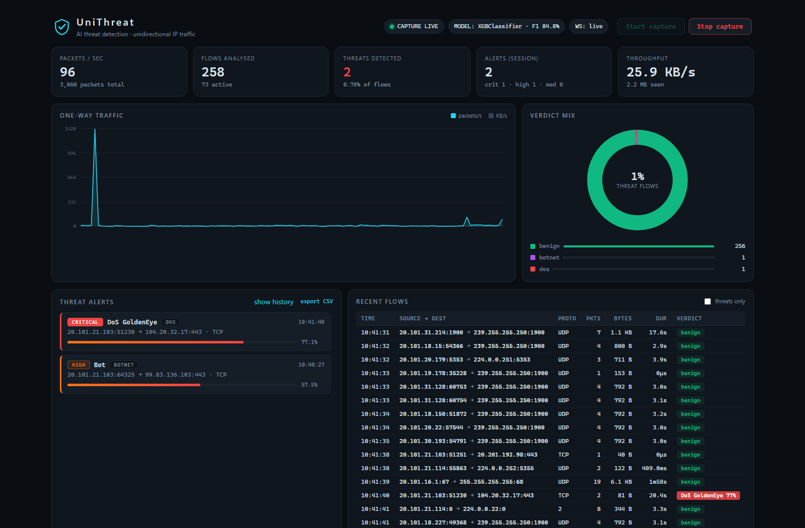

# UniThreat

**AI-based detection of cyber threats in unidirectional IP traffic on a server.**

UniThreat is a production-grade network intrusion detection sensor designed to
sit at the **receiving end of a data diode (unidirectional gateway)**. It
captures one-way IP traffic, folds it into unidirectional flows, extracts
CICFlowMeter-compatible features, and classifies every flow with a trained
XGBoost / Random Forest model — surfacing live verdicts, alerts and traffic
analytics through a built-in web dashboard and REST/WebSocket API.

```
   PROTECTED ENCLAVE            DATA DIODE              RECEIVING SERVER
  ┌──────────────────┐   ══════════════════▶  ┌──────────────────────────────┐
  │  workstations,   │    (one-way only)      │ UniThreat sensor            │
  │  SCADA, servers  │                        │                              │
  └──────────────────┘                        │  capture ─▶ flow tracking    │
                                              │      │                        │
                                              │      ▼                        │
                                              │  43-feature extraction      │
                                              │      │                        │
                                              │      ▼                        │
                                              │  ML detector (XGB / RF)      │
                                              │      │                        │
                                              │      ▼                        │
                                              │  alert manager ─▶ SQLite     │
                                              │      │                        │
                                              │      ▼                        │
                                              │  dashboard + REST/WS API     │
                                              └──────────────────────────────┘
```

## The dashboard

**Demo replay** — recorded CIC-IDS2017 attack traffic (port scans, DDoS floods,
slowloris, brute-force) being detected in real time as it replays through the sensor:



**Live mode** — the same sensor watching real network traffic; mostly green
"benign" verdicts, which is exactly what a healthy network should look like:



## Why "unidirectional" matters

A data diode guarantees that traffic can only flow one way (e.g. from a
low-security network into a high-security one). That stops inbound attacks —
but the *outbound stream itself* can still be malicious or leak data:

* **data exfiltration** — insiders/malware shipping data out
* **malware beaconing** — infected hosts calling C2 infrastructure
* **denial-of-service / floods** — the enclave participating in attacks
* **reconnaissance** — port scans riding the allowed path
* **covert channels** — slow-rate and low-and-slow abuse

UniThreat is built for exactly that view: it never assumes it can see both
directions of a conversation. Flows are keyed by the **one-way 5-tuple**, and
the model is trained only on features observable in the sender→receiver
stream (the "forward" feature family of CIC-IDS2017).

## Key features

* **Real deployment design** — live Scapy capture (Npcap/libpcap), direction
  filtering (`outbound` / `inbound`, fail-closed with loud warnings), BPF
  pre-filters, memory-bounded flow table (idle + active timeouts, overflow
  eviction), graceful degradation when the model is missing.
* **Train/serve consistency by construction** — every dataset flow used for
  training is rendered into a packet stream and re-extracted through the
  *same* flow accumulator the sensor uses at runtime (see
  [Design notes](#design-notes--limitations)). The CICFlowMeter CSV columns
  carry capture-tool artefacts that no physical packet can reproduce, so the
  model learns the sensor's own feature semantics instead.
* **Trained on CIC-IDS2017** (2.8M labeled flows; sha256-verified download)
  with RF vs XGBoost comparison, macro-F1 model selection, per-class metrics,
  binary threat-detection metrics, and a full confusion matrix.
* **Alerting** — severity/category taxonomy, deduplication (same threat + same
  endpoint merges into one alert with an occurrence counter), and an
  append-only SQLite history with non-blocking writes.
* **Live dashboard** — dark security-console UI (no external JS dependencies):
  live packets/s + throughput chart, verdict mix donut, threat alert feed,
  flow table, capture start/stop, CSV export, WebSocket push.
* **Offline analysis** — replay any pcap headlessly
  (`scripts/replay_pcap.py`) or through the dashboard.
* **Demo generators** — `scripts/render_flows.py` renders real dataset attack
  flows into a pcap (the model actually fires on them);
  `scripts/simulate_traffic.py` generates generic synthetic traffic without
  needing the dataset.

## Results (shipped model)

Trained on CIC-IDS2017 with `--cap 120000` flows/class, **live feature
mode**, hold-out test of 103,924 flows:

| metric | value |
|---|---|
| selected model | XGBoost (over Random Forest) |
| accuracy | **0.9930** |
| threat detection (any-attack vs benign) | precision **0.9951** · recall **0.9985** · F1 **0.9968** |
| DDoS / DoS Hulk / PortScan F1 | 0.9992 / 0.9998 / 0.9998 |
| FTP/SSH-Patator F1 | 0.9987 / 0.9975 |
| DoS GoldenEye / slowloris / Slowhttptest F1 | 0.9937 / 0.9748 / 0.9566 |

Small classes remain hard (Web Attack - XSS F1 0.30 with 130 test samples;
SQL Injection 0.24 with 4) — a well-known property of CIC-IDS2017. Full
details: `models/training_report.md`, `models/metrics.json`.

## Repository layout

```
config.yaml                  main configuration (all commented)
src/
  capture/                   packets -> flows: sources, direction, flow table, pipeline
  features/                  canonical schema + live feature accumulation
  synthesis/                 dataset rows -> packet rendering (train + demo)
  dataset/                   CIC-IDS2017 loading & canonicalisation
  ml/                        training, evaluation, live detector
  alerts/                    dedup manager + SQLite store
  server/                    FastAPI app, event hub, dashboard (static/)
scripts/                     download_data, train, run_server, replay_pcap,
                             render_flows (demo), simulate_traffic
tests/                       50 unit + integration tests (no NIC required)
models/                      trained artifacts (latest_model.joblib, metrics, report)
data/                        datasets, alert DB, demo pcaps
```

## Quickstart

### 1. Install

```bash
# Python 3.10+ (3.12+ recommended)
pip install -r requirements.txt

# live capture needs a packet driver:
#   Windows: Npcap (https://npcap.com, enable "loopback + WinPcap API")
#   Linux:   libpcap (usually preinstalled)
```

### 2. Download CIC-IDS2017

```bash
# recommended: parquet mirror of the TrafficLabelling variant (~306 MB)
python scripts/download_data.py

# alternatives:
python scripts/download_data.py --source machine_learning   # 261 MB parquet
python scripts/download_data.py --source csv                # 884 MB original CSVs
python scripts/download_data.py --list-only                  # see what's included
```

Downloads resume automatically and are sha256-verified against the mirror's
metadata. Files land in `data/raw/cicids2017/<source>/`. If you already have
the dataset (e.g. the official UNB download), just point the training script
at your folder of CSV/parquet files.

### 3. Train the model

```bash
# recommended: balanced classes, live feature mode (default) — ~3 min
python scripts/train.py --data data/raw/cicids2017/traffic_labels --cap 120000

# full dataset (needs a few GB RAM)
python scripts/train.py --data data/raw/cicids2017/traffic_labels

# classic mode: train on the raw CICFlowMeter columns instead
python scripts/train.py --data <dir> --raw-features
```

Outputs in `models/`: `latest_model.joblib` (the bundle the server loads),
`metrics.json`, `feature_importances.json`, `training_report.md`.

### 4. Watch it detect attacks (demo)

```bash
# build a demo pcap out of REAL CIC-IDS2017 attack flows...
python scripts/render_flows.py --verify
#    -> verifies through the offline pipeline and prints the verdict mix

# ...and replay it through the dashboard, looping forever:
python scripts/run_server.py --backend replay --pcap data/demo/demo_traffic.pcap
# open http://127.0.0.1:8000 — alerts appear per episode (PortScan, DDoS,
# Hulk, slowloris, patators, Bot, web attacks...)
```

No dataset yet? `python scripts/simulate_traffic.py` writes a synthetic
pcap (benign background + generic attack episodes) that needs no download.

### 5. Deploy for real

```bash
# configure what to watch (config.yaml)
capture:
  backend: "live"
  direction: "outbound"          # watch what LEAVES the trusted network
  trusted_cidrs: ["192.168.10.0/24"]

# list interfaces:  python -c "from scapy.config import conf; print(conf.ifaces)"
python scripts/run_server.py --interface "Ethernet"
```

On the receiving side of the diode use `direction: "inbound"` with
`monitored_hosts: [<server IPs>]` instead.

## How detection works

1. **Capture** — Scapy sniffs the diode interface with a BPF pre-filter; a
   `DirectionFilter` enforces the configured one-way semantics in-process
   (fail-closed: an unconfigured filter drops everything and raises a
   dashboard warning).
2. **Flow tracking** — packets fold into flows keyed by the one-way 5-tuple.
   A flow closes after 30 s of silence (idle timeout), 120 s of continuous
   activity (active timeout), or memory-guard eviction.
3. **Feature extraction** — each closed flow yields the 43 canonical features:
   packet counts/bytes, length statistics, inter-arrival statistics,
   TCP flag counts, initial window, payload segment stats, and active/idle
   period statistics (gap threshold 5 s, CICFlowMeter-compatible).
4. **Classification** — the XGBoost/RF model returns a label (BENIGN, DDoS,
   DoS Hulk, PortScan, Bot, Infiltration, Web Attack -*, …) with a
   confidence. Verdicts below `detection.min_confidence` are marked
   low-confidence and never raise alerts.
5. **Alerting** — threat verdicts map to a severity
   (`critical`/`high`/`medium`/`low`) and category
   (`dos`, `reconnaissance`, `botnet`, `web-attack`, `brute-force`,
   `infiltration`, `exploit`). Repeated hits within the dedup window merge.

## Web API

| Method | Path | Description |
|---|---|---|
| GET  | `/api/status` | capture/model/alerts status |
| GET  | `/api/stats` | counters + per-second traffic timeline |
| GET  | `/api/flows?limit=&threats_only=` | recent flows with verdicts |
| GET  | `/api/alerts?severity=&label=` | alert history (SQLite-backed) |
| GET  | `/api/alerts/export.csv` | CSV export |
| GET  | `/api/model` | model metadata + hold-out metrics |
| GET  | `/api/config` | effective configuration |
| POST | `/api/capture/start` \| `/api/capture/stop` | control capture |
| WS   | `/ws` | live events (snapshot, flow, alert, capture state) |

Interactive docs: `http://<host>:<port>/docs`

## Configuration

Everything lives in [`config.yaml`](config.yaml): server bind address,
capture backend/interface/direction, CIDR lists, flow timeouts, model path and
confidence threshold, alert dedup window, SQLite path, training parameters.
CLI flags on `scripts/run_server.py` override the file.

## Deployment

* **Linux systemd** — see [`deploy/unithreat.service`](deploy/unithreat.service)
* **Docker** — `docker compose up --build` (live capture needs host
  networking on Linux); offline/replay mode via `docker-compose.offline.yml`

## Testing

```bash
python -m pytest tests/ -q        # 50 tests: features, flow table, dataset,
                                  # renderer, train+detect, alerts, API/WS
```

## Design notes & limitations

* **Feature parity & dataset artefacts.** The CICFlowMeter columns of
  CIC-IDS2017 contain values that no physical packet stream can produce —
  e.g. the PortScan class is dominated by flows with 2-byte "total length of
  forward packets", and forward/backward IATs assume a bidirectional capture.
  Training directly on those columns makes a model that classifies *CSV rows*
  well but real packets poorly (this was measured: 100% accuracy on raw rows,
  0% on faithfully synthesized packets). UniThreat therefore renders every
  training flow through the sensor's own extractor (`--live-features`,
  the default) so the model learns exactly what the sensor computes. The
  `--raw-features` mode remains available for comparison/research.
* **Active/Idle approximation** — CICFlowMeter's exact activity semantics are
  undocumented in places; UniThreat closes an activity period when the
  inter-packet gap exceeds 5 s. Period statistics use population std.
* **Zero-duration flows** — single-packet flows get rates of 0 (the dataset
  encodes them as ±inf; those are cleaned to medians during raw-mode
  training).
* **Domain shift** — like every NIDS trained on CIC-IDS2017, expect some
  false positives on real traffic; tune `detection.min_confidence`, the
  per-class cap, or retrain on site-specific captures. The low-confidence
  flag exists exactly for this.
* **Throughput** — a single inference thread sustains a few thousand flow
  verdicts/s on commodity hardware; the flow table is memory-bounded via
  `flow.max_concurrent_flows`. For 10G+ links, shard capture across
  processes.
* **IPv4 only** in the current feature pipeline (the dataset is IPv4);
  IPv6 support is a roadmap item. UNSW-NB15 support is on the roadmap too
  (the dataset module is designed for additional adapters).

## License

MIT — see [LICENSE](LICENSE). The CIC-IDS2017 dataset is owned by the
Canadian Institute for Cybersecurity; cite their paper if you use it:
Sharafaldin, Lashkari & Ghorbani, *"Toward Generating a New Intrusion
Detection Dataset and Intrusion Traffic Characterization"*, ICISSP 2018.
